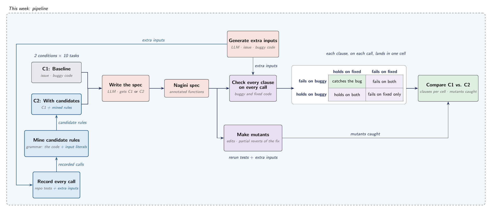

# spec-miner

Does mining rules from execution traces help an LLM write better specs for
real bug fixes?

For a SWE-bench task, an LLM writes a Nagini spec (Python pre- and
postconditions) for the code an issue is about, optionally helped by rules
mined from traced calls. Each spec is then checked by running it, on the
buggy and the fixed code, and on mutants of the fix.



## The pipeline

`python -m run CONFIG.toml` runs every step for each task in the config.
A step whose output already exists is skipped, so a stopped run carries on
with `--resume RUN_DIR`.

| step | what it does | code | writes |
|---|---|---|---|
| 1. trace | runs the task's tests in its SWE-bench container, on buggy and on fixed code, and records every call to the changed files' functions and their direct callers and callees | `tracing/` | `1_traces/`, `1_traces_fixed/` |
| 2–3. mine | builds a grammar from each function's own code (its literals, the methods it calls, and the traced variables), enumerates terms bottom-up, and keeps the rules that hold on every recorded call | `mining/` | `2_grammar/`, `3_candidates/` |
| 4. specs | one LLM call per condition, writing a Nagini spec | `llm/write_spec.py` | `4_specs/` |
| 4. inputs | one LLM call writing extra calls from the issue and the buggy code | `llm/write_inputs.py` | `4_inputs/` |
| 5. check | wraps the spec's functions, runs the tests (and the extra calls) on buggy and fixed code, and puts each clause, on each call, in one of four cells: catches the bug, holds on both, fails on fixed only, fails on both | `check/run.py`, `check/live.py`, `check/compare.py` | `5_check/` |
| 6. mutants | makes mutants of the fixed code (generic edits, and partial reverts of the fix) and counts which ones each spec, and the repo's tests, catch | `check/mutate.py`, `check/mutation.py` | `6_mutants/` |

Each module's docstring explains its step in more detail.

## Setup

Needs Python 3.11+, Docker, and the SWE-bench images for your tasks (pulled
on first use).

```
pip install -e ".[llm,dev]"
```

The LLM steps use [litellm](https://github.com/BerriAI/litellm), so set the
credentials for your provider in the environment (we use Bedrock). Every
run has a dollar budget, and LLM steps stop once it's spent.

The task list is a JSON file of SWE-bench tasks (`image`, `patch`,
`test_patch`, `problem_statement`, `F2P`, `P2P`, ...). It isn't in the repo;
point `tasks_file` in the config at your copy.

## Running

```
cd src
python -m run ../exp/configs/three_arms.toml
python -m run ../exp/configs/three_arms.toml --resume ../results/three_arms_<time>
```

The main settings in a config:

```toml
tasks_file = "~/path/to/tasks.json"
tasks = ["psf__requests-1142", "scikit-learn__scikit-learn-14983"]

[trace]
depth = 1            # levels of fields to follow into recorded objects

[mine]
max_size = 3         # largest term
min_support = 2      # fewest calls for a rule
f2p = "exclude"      # leave out calls from the bug's own tests
scope = "function"   # grammar from the function's code, or "file"

[llm]
model = "bedrock/us.anthropic.claude-opus-4-5-20251101-v1:0"
budget = 7.0         # dollars for the whole run
```

Results go to `results/<name>_<time>/`, one folder per step, and
`summary.txt` has a table of mutants caught and clause cells for every task
and condition.

## Tests

```
pytest
```
